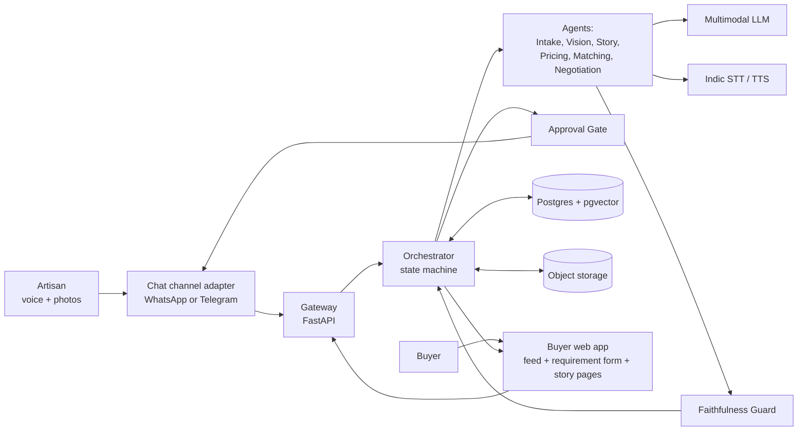
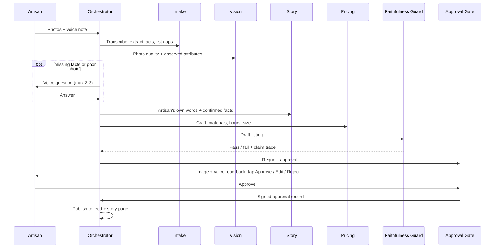
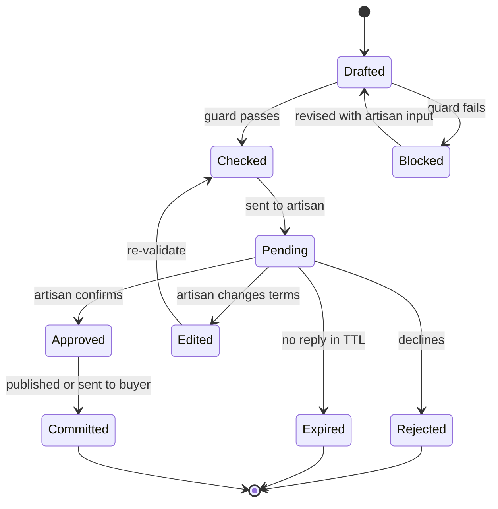

# Architecture: ShilpSaathi (Problem 7.1, Prototype Round)

> Tech4Bharat / GAVS Hackathon, Problem 7.1: *Artisans and weavers depend on middlemen and rarely reach buyers who value their craft.* Track: Agentic AI.

**Goal:** minimal for the artisan, maximum difference in outcome. The artisan's whole product is **one voice note and two taps**. Everything else is the agent's job.

**Confidence tags:** **[Certain]** from the problem statement, **[Likely]** strong inference, **[Guessing]** assumption to validate.

---

## 1. The Product in One Paragraph

An artisan sends photos and a voice note on a chat app. An agent builds a faithful listing under the maker's name, writes the story from the artisan's own words, and suggests a price band backed by cited comparables. A buyer posts a requirement; a matching agent shortlists artisans and drafts a proposal. The artisan approves, edits or declines with a tap. **Agents propose; a code-level approval gate decides what is ever committed.** **[Certain]** This is the stated boundary.

## 2. Prototype Scope (what is real vs. simulated)

| Area | Prototype status |
|---|---|
| Artisan intake (photos + voice note, one regional language + English/Hindi) | **Real** |
| Faithfulness Guard with per-claim trace | **Real** |
| Pricing band with cited comps | **Real logic, seed data** (curated, labelled as seed in UI) |
| Approval Gate (state machine, audit log) | **Real** |
| Story page + QR with maker name and voice clip | **Real** |
| Buyer feed + "Post a requirement" form | **Real, minimal** (read-only feed of seeded posts) |
| Matching Agent → drafted proposal → artisan approval | **Real** |
| Open-network connector, UPI links, logistics, IVR, co-op dashboard | **Not built** (roadmap) |
| Real artisans and buyers | **Not required this round**; demo uses test personas. Do not claim real-world uplift **[Certain]** |

Cut on purpose: likes, comments, follows, feed ranking, multi-craft breadth beyond 2 or 3 seeded crafts.

---

## 3. System Context



**Channel adapter:** WhatsApp Business Cloud API is the target, but its setup and test-number limits can eat prototype time **[Likely]**. Build the adapter interface so Telegram or a web chat that mimics WhatsApp can stand in with no changes to the core. **[Guessing]** on which is fastest for your team.

---

## 4. Core Flows

### 4.1 Artisan: voice note to approved listing



### 4.2 Buyer requirement to artisan-approved proposal

1. Buyer submits: item, quantity, deadline, budget (optional).
2. **Matching Agent** shortlists seeded artisans by craft, declared capacity and region. Ranking is a simple scored filter, not a learned model.
3. **Negotiation Agent** drafts a proposal and a short voice brief for each shortlisted artisan: *"Buyer wants 40 pieces by Dec 20. Market band ₹A–₹B. Your floor ₹F. Suggested counter ₹C with 25% advance."*
4. Artisan taps **Approve / Edit / Decline.** Only then does the buyer see a proposal.
5. Agents may send **non-binding** acknowledgements only ("the maker will confirm").

### 4.3 Approval state machine



**Invariants (each gets an automated test):**
- Nothing reaches `Committed` without an `Approved` record from the maker.
- `Expired` never auto-approves.
- Any change to price, quantity or deadline after approval starts a new approval cycle.
- Approval records are append-only and store the exact content approved (snapshot + hash).

---

## 5. Components

| # | Component | Responsibility | Hard constraint |
|---|---|---|---|
| 1 | **Channel adapter + Gateway** | Receive voice, photos, button taps; send voice and image replies | Signature-verified webhooks |
| 2 | **Orchestrator** | Per-artisan state machine; routes to agents; retries and timeouts | Deterministic control flow; LLMs only fill bounded slots |
| 3 | **Agents** (Intake, Vision, Story, Pricing, Matching, Negotiation) | Typed inputs and outputs, JSON-schema outputs | Cannot call commit endpoints |
| 4 | **Faithfulness Guard** | See 5.1 | Blocks unsourced claims |
| 5 | **Approval Gate** | State machine in code, audit log | Only path to `Committed` |
| 6 | **Buyer web app** | Seeded feed, requirement form, story pages, QR | Read-only for buyers; no accounts needed for the prototype |

### 5.1 Faithfulness Guard
Answers *"presentation has to stay faithful to the product."* **[Certain]**
1. Split the draft into atomic claims ("hand-woven", "natural dye", "60 × 40 cm").
2. Each claim must link to a source: `ARTISAN_STATED` (transcript timestamp), `IMAGE_OBSERVED` (vision output, artisan-confirmed), or `REFERENCE` (curated craft notes, labelled general).
3. Reject unsourced claims, superlatives, and certification words (GI, organic, handloom mark) without a document.
4. Image edits are non-generative only (crop, exposure, white balance); originals retained; colour difference measured and capped.
5. Store the claim → source trace with the approval record. Show it in the demo as "why this listing is trustworthy."

### 5.2 Pricing Engine
LLMs invent plausible numbers, so **code computes, the model explains.**
```
cost_floor  = material_cost + hours × labour_rate + overhead
market_band = percentile(matched_comps, 25..75)    # match craft, material, size
recommended = max(band_mid, cost_floor × (1 + min_margin))
confidence  = f(comp_count, match_quality, recency)
```
- Fewer than N matched comps → show **low confidence** and the cost floor only.
- Always show the top 3 comps with source and date.
- Show two numbers: what a distant buyer pays, and what to ask at the workshop gate. This addresses the problem's *"following the money"* prompt. **[Certain]**
- Prototype comps: a curated seed set (~100–300 rows, 2–3 crafts), labelled "seed data". Live sources are **[Guessing]** until access and terms are checked.

### 5.3 Story and provenance
- **Craft Passport** per product: maker name, village or cluster, craft, technique, materials, hours, process photos, original-language voice clip, approval timestamp.
- Public mobile page at `/p/{id}` with the maker's name first, plus a printable QR.
- Verification tier shown honestly: *Self-declared* by default. Higher tiers only with documents.

---

## 6. Data Model (core)

```
artisan(id, name, language, region, capacity_per_week, phone_hash, consent_at)
product(id, artisan_id, craft, materials[], dims, hours, status)
media(id, product_id, kind[original|enhanced|process|voice], uri, sha256)
fact(id, product_id, key, value, source, evidence_ref, confirmed_at)
listing(id, product_id, version, content_json, guard_trace_json, state)
price_quote(id, product_id, floor, band_low, band_high, confidence, comps_json)
comp(id, craft, material, size_cm, price, source, observed_at)
requirement(id, buyer_ref, item, qty, deadline, budget, raw_text)
proposal(id, requirement_id, artisan_id, terms_json, state)
approval(id, subject_type, subject_id, content_snapshot, content_hash, decision, decided_at)  -- append-only
audit_event(id, actor, action, subject, ts, payload)
```
Postgres + pgvector for relational data and comp/craft-note retrieval. **[Likely]** sufficient at prototype scale.

---

## 7. AI Stack

| Need | Choice | Confidence |
|---|---|---|
| Photo + text reasoning | Multimodal LLM with solid Indic-language support | [Likely] |
| Speech to text | Cloud STT or open Indic ASR; test on your own recordings | [Guessing] on best option |
| Voice replies | Cloud TTS, Indic voices | [Likely] |
| Structured output | JSON-schema constrained, Pydantic validation, retry | [Certain] pattern |
| Image enhancement | Classical CV (crop, exposure, white balance) | [Likely] |

Principle: **numbers come from code and data; language comes from the model.**

---

## 8. Security and Trust (prototype-level)
- Record consent in the artisan's language before storing voice or photos. India's DPDP Act (2023) applies to real deployments **[Likely]**; get proper advice before production.
- Buyer text is untrusted input. Buyer-facing agents have no tool access to commit actions. The gate is code, not a prompt.
- Hash phone numbers at rest; secrets in environment variables only.

## 9. Evaluation (what you can honestly report)

| Metric | Method |
|---|---|
| Faithfulness | Planted-error set: listings with injected unsupported claims; report guard catch rate |
| Approval invariants | Property tests attempting to commit via every route; target 0 bypasses |
| Pricing sanity | Held-out comps; verify low-confidence behaviour on sparse data |
| Speech quality | WER on your own recordings in the demo language |
| Time to first listing | Teammate who did not build it, photo to approved listing |

Report results as prototype measurements on seed data. Do not claim real-world income uplift **[Certain]**.

## 10. Demo Script (5 minutes)
1. Artisan persona sends photos + a voice note (regional language).
2. Agent asks one follow-up; artisan answers by voice.
3. Read-back screen shows the listing with the **claim trace**; one planted false claim gets blocked live.
4. Price band appears with cited comps; show distant-buyer price vs. workshop-gate price.
5. Artisan taps Approve; the listing appears in the buyer feed with the maker's name and QR.
6. Buyer posts a requirement; the Matching Agent drafts a proposal; the artisan approves with one tap.
7. Close on the audit log: every commitment, who approved it, and exactly what they saw.

## 11. Risks

| Risk | Mitigation |
|---|---|
| Judging criteria and format unverified | Confirm in the organiser channel |
| Chat-app setup eats build time | Channel adapter; fall back to Telegram or web chat |
| Seed comps look fake | Label clearly; explain method; show low-confidence behaviour |
| STT errors put wrong facts in listings | Mandatory read-back before publish |
| Scope creep into social features | Stick to the cut list in section 2 |
| Prototype claims overreach | State plainly what is simulated |

## 12. Roadmap (post-prototype)
Field validation with real artisans, live comps pipeline, cooperative admin dashboard, open-network seller integration, UPI payment links with maker-approved payee, document-verified provenance tiers, logistics.

## 13. Repo Layout
```
/apps   gateway/  orchestrator/  buyer-web/
/agents intake/ vision/ story/ pricing/ matching/ negotiation/
/core   faithfulness_guard/ approval_gate/ models/ audit/
/data   seed_comps/ craft_notes/ seeded_artisans/
/eval   planted_errors/ approval_property_tests/ pricing_checks/
/infra  docker-compose.yml
ARCHITECTURE.md
```
